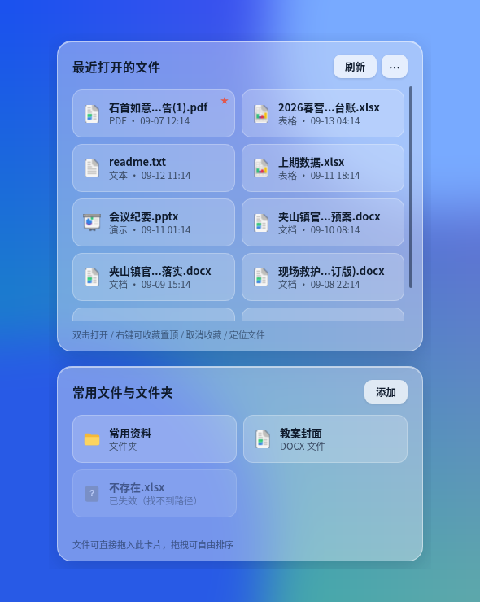

<div align="center">


# Desktop File Widget · 桌面文件小组件

**A tiny, beautiful Windows desktop widget for your recent files and favorite folders.**<br/>
**一个小巧好看的 Windows 桌面小组件：最近打开的文件 + 常用文件与文件夹，一眼可见，双击即开。**

[](https://github.com/a221333/desktop-file-widget/releases/latest)


[](LICENSE)

[English](#english) · [中文](#中文)



</div>

---

## English

### Why?

Windows hides your recent files behind Explorer's *Quick access* or each app's own "Recent" menu. **Desktop File Widget** puts them right on your desktop as a frosted-glass card, next to a second card of folders and files you use every day, so you can open them with one double-click.

### ✨ Highlights

- **🪶 Tiny & fast:** about **4 MB** (installer about 1.4 MB). Built with Rust + Tauri on the system WebView2, with no bundled Chromium. Uses almost no memory or CPU while idle.
- **🕘 Recent files, automatically:** reads the Windows *Recent* list (works with WPS, Office, PDF readers, and any app that registers recent files). Updates by itself the moment you open something.
- **🏷️ Knows the app:** every item shows its real system icon, the app that opens it (*WPS*, *Word*, *Excel*, *Acrobat*…), and when you last opened it.
- **⭐ Pin what matters:** right-click to pin a recent file to the top so it never scrolls away, or remove things you don't want to see.
- **📁 Favorites card:** drag files or folders straight from Explorer, drag tiles to reorder, rename how they're displayed, and spot moved or deleted paths at a glance.
- **🧭 OneCommander edition:** a dedicated build that opens folders and *Show in folder* in [OneCommander](https://onecommander.com/) instead of Explorer. It finds OneCommander automatically (Store, portable, PATH, or the running process).
- **📝 Tracks files opened in OneCommander (OC edition):** OneCommander doesn't write to the Windows *Recent* list, so the OC edition watches the apps it starts and adds the files they open to *Recent files*. You can turn this off in the **⋯** menu.
- **🎨 Looks at home on Windows 11:** frameless translucent cards, three opacity levels, and Chinese-friendly *middle* ellipsis for long file names (`2026春营...台账.xlsx`).
- **🧩 Stays out of the way:** no taskbar button, lives in the tray, remembers its position and size, with optional always-on-top and start-with-Windows.
- **🔒 Private by design:** no telemetry; the only network request is a version check against GitHub Releases. Settings are a single local JSON file.

### 📦 Download

Get the latest version from **[Releases](https://github.com/a221333/desktop-file-widget/releases/latest)**:

| File | Description |
|---|---|
| `DesktopFileWidget-x.y.z-portable.exe` | Standard edition, portable single exe |
| `DesktopFileWidget-x.y.z-setup.exe` | Standard edition installer |
| `DesktopFileWidget-OneCommander-x.y.z-portable.exe` | OneCommander edition, portable |
| `DesktopFileWidget-OneCommander-x.y.z-setup.exe` | OneCommander edition installer |

> Requires Windows 10/11 with WebView2 (already built into Windows 11 and up-to-date Windows 10).
> The binaries are not code-signed. If SmartScreen appears, click **More info → Run anyway**.

**Updating:** the widget checks for new versions on startup (or via **⋯ → 检查更新 (Check for updates)**) and downloads the right file for your edition. Running a newer installer upgrades the existing install in place; your favorites and settings are kept. The standard and OneCommander editions install separately and can coexist.

### 🖱️ Usage

| Action | Recent files | Favorites |
|---|---|---|
| Double-click | Open | Open (folders open in OneCommander in the OC edition) |
| Right-click | Pin to top / Unpin · Show in folder · Add to favorites · Copy path · Remove from list | Open · Show in folder · Rename · Copy path · Remove |
| Drag | Drop onto the Favorites card to add | Reorder; drop files/folders from Explorer to add |

Drag a card's title bar to move the widget. Use the **⋯** button for settings (opacity, always on top, start with Windows, include folders, OneCommander path…), and the tray icon to show, hide, or quit.

### 🛠️ Build from source

Requires Node.js 18+ and Rust (stable).

```bash
npm install
npm run dev        # run in development
npm run build      # standard edition
npm run build:oc   # OneCommander edition
```

Pushing a `v*` tag triggers GitHub Actions, which builds both editions on Windows and publishes a release.

---

## 中文

### 为什么做它？

Windows 的"最近文件"藏在资源管理器的「快速访问」或各个软件自己的菜单里，找起来很麻烦。**桌面文件小组件**把它们直接放到桌面上，做成一张毛玻璃卡片；下面再加一张卡片放你每天都用的文件和文件夹，**双击就能打开**。

### ✨ 软件特色

- **🪶 小巧轻快**：程序只有约 **4 MB**（安装包约 1.4 MB）。用 Rust + Tauri 开发，调用系统自带的 WebView2，不内置浏览器，后台几乎不占内存和 CPU。
- **🕘 自动显示最近文件**：读取 Windows 系统的最近文件列表，WPS、Office、PDF 阅读器等软件打开过的文件都会出现，刚打开的文件马上就能看到。
- **🏷️ 显示打开方式**：每一项都显示系统图标、打开它的软件（WPS / Word / Excel / Acrobat…）和最近打开的时间，比如 `WPS · 09-13 04:14`。
- **⭐ 收藏置顶**：右键可以把重要文件固定在最前面，不会被新打开的文件挤下去；不想看到的也能从列表里移除。
- **📁 常用文件与文件夹**：从资源管理器直接拖进卡片就能收藏，拖动可以排序，还能改显示名称；文件被移动或删除后会变灰提示。
- **🧭 OneCommander 特供版**：文件夹和「定位文件」用 [OneCommander](https://onecommander.com/) 打开，不再弹出资源管理器。会自动查找 OneCommander（商店版、便携版、PATH、正在运行的程序），找不到时会提示你手动选择。
- **📝 记录 OneCommander 中打开的文件（特供版）**：OneCommander 打开文件时不会写入系统「最近」列表，特供版会监测由它启动的程序，把打开的文件加入「最近打开的文件」。可在 **⋯** 菜单中关闭。
- **🎨 和 Windows 11 风格一致**：无边框半透明卡片，背景不透明度有三档可调；长文件名在中间省略，开头和扩展名都看得到（`2026春营...台账.xlsx`）。
- **🧩 不打扰**：不占任务栏，常驻托盘；记住窗口位置和大小；可以设置始终置顶和开机自启。
- **🔒 注重隐私**：不收集任何数据，唯一的联网操作是向 GitHub 查询是否有新版本，所有设置只保存在本地一个 JSON 文件里。

### 📦 下载

到 **[Releases](https://github.com/a221333/desktop-file-widget/releases/latest)** 下载最新版：

| 文件 | 说明 |
|---|---|
| `DesktopFileWidget-x.y.z-portable.exe` | 普通版，便携 exe，双击就能用 |
| `DesktopFileWidget-x.y.z-setup.exe` | 普通版安装包 |
| `DesktopFileWidget-OneCommander-x.y.z-portable.exe` | OneCommander 特供版，便携 exe |
| `DesktopFileWidget-OneCommander-x.y.z-setup.exe` | OneCommander 特供版安装包 |

> 需要 Windows 10/11 和 WebView2（Win11 和保持更新的 Win10 已经自带）。
> 程序没有数字签名，第一次运行如果弹出 SmartScreen 提示，点「更多信息 → 仍要运行」。

**更新方法：** 小组件启动时会自动检查新版本（也可以点 **⋯ → 检查更新**），并下载与你当前版本对应的文件。安装版直接运行新的安装包即可覆盖升级，常用列表和设置都会保留；便携版用新 exe 替换旧的即可。普通版和特供版分别安装，可以共存。

### 🖱️ 使用方法

| 操作 | 最近打开的文件 | 常用文件与文件夹 |
|---|---|---|
| 双击 | 打开 | 打开（特供版中文件夹用 OneCommander 打开） |
| 右键 | 收藏置顶 / 取消收藏 · 定位文件 · 添加到常用 · 复制路径 · 从列表中移除 | 打开 · 定位文件 · 重命名显示名称 · 复制路径 · 移除收藏 |
| 拖拽 | 拖到「常用」卡片即可收藏 | 拖动排序；从资源管理器拖入即可收藏 |

拖动卡片标题栏可以移动小组件；右上角 **⋯** 菜单里可以调整不透明度、始终置顶、开机自启、最近列表是否包含文件夹、OneCommander 路径等；托盘图标可以显示、隐藏或退出。

两个版本的设置互相独立，可以同时安装。配置文件位置：`%APPDATA%\com.a221333.desktopfilewidget\config.json`（特供版为 `…desktopfilewidget.oc`）。

### 🛠️ 从源码构建

需要 Node.js 18+ 和 Rust（stable）。

```bash
npm install
npm run dev        # 开发运行
npm run build      # 普通版
npm run build:oc   # OneCommander 特供版
```

推送 `v*` 标签后，GitHub Actions 会在 Windows 上自动构建两个版本并发布到 Release。

---

<div align="center">

MIT License · Made with ❤️ and [Tauri](https://tauri.app/)

</div>
